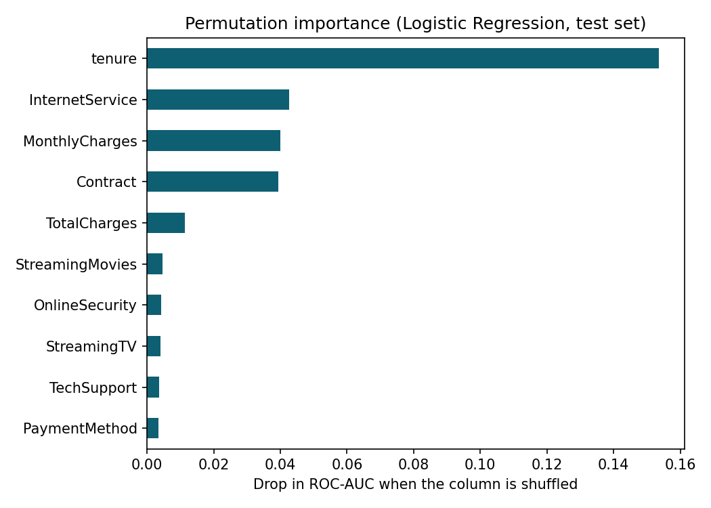

# Telco Customer Churn Prediction

Predict which telecom customers are about to cancel their service, so a retention team knows **who to call first**.

**Result on the held-out test set:** the final model catches **78% of customers who leave** (recall 0.78, F1 0.61, ROC-AUC 0.84), up from 56% for the baseline.

## Problem

- **Data:** [Telco Customer Churn (Kaggle / IBM)](https://www.kaggle.com/datasets/blastchar/telco-customer-churn): 7,043 customers, 20 features, 26.5% churn.
- **Task:** binary classification (Churn = Yes / No).
- **Main metric: recall.** Missing a customer who leaves costs more than one unnecessary retention call, so the goal is to catch as many leaving customers as possible while keeping precision ≥ 0.5 (at least one in two calls reaches a real churner).
- Accuracy is not used: a model that predicts "nobody leaves" already scores 73.5%.

## Approach

1. **Cleaning:** `TotalCharges` was stored as text; 11 blank values (all new customers with tenure 0) were set to 0. Dropped `customerID`.
2. **EDA:** churn rate by category and by tenure / monthly charges (`images/`).
3. **Split:** 80/20 train/test, stratified. The test set was used **once**, at the very end.
4. **Pipeline:** `ColumnTransformer` (StandardScaler for numeric, OneHotEncoder for categorical) + model, so no preprocessing leaks from validation data.
5. **Model comparison** with 5-fold stratified cross-validation on the training set: Logistic Regression, Decision Tree, Random Forest, XGBoost (class imbalance handled with `class_weight='balanced'` / `scale_pos_weight`).
6. **Model choice:** Logistic Regression. The tree ensembles scored about the same F1 on validation but overfit (large train–validation gap); logistic regression is simpler, stable and had the highest recall.
7. **Threshold:** chosen on out-of-fold validation predictions (`cross_val_predict`), not on the test set. 0.5 is the lowest threshold that keeps precision ≥ 0.5.

## Results (test set, 1,409 customers, 374 churners)

|                       | Baseline (LogReg, default) | **Final (LogReg balanced, thr 0.5)** |
|-----------------------|---------------------------:|-------------------------------------:|
| Churners caught (TP)  | 209                        | **293**                              |
| Churners missed (FN)  | 165                        | **81**                               |
| False alarms (FP)     | 109                        | 288                                  |
| Precision             | 0.66                       | 0.50                                 |
| Recall                | 0.56                       | **0.78**                             |
| F1                    | 0.60                       | **0.61**                             |
| ROC-AUC               | –                          | **0.84**                             |

Trade-off: **179 more calls to save 84 more customers.** Validation and test scores differ by about 0.02, so the model does not overfit.

| Threshold | Precision | Recall | Customers flagged (train, OOF) |
|----------:|----------:|-------:|-------------------------------:|
| 0.3 | 0.42 | 0.93 | 3,263 |
| 0.4 | 0.47 | 0.87 | 2,751 |
| **0.5** | **0.52** | **0.80** | **2,318** |
| 0.6 | 0.57 | 0.72 | 1,884 |
| 0.7 | 0.63 | 0.59 | 1,410 |

The threshold is a business decision: a team with fewer agents can raise it to call fewer, higher-risk customers.

## What drives churn



Permutation importance (drop in test ROC-AUC when a column is shuffled):

1. **Tenure** (0.154) — by far the strongest signal: new customers leave most.
2. **Internet service** (0.043) — fiber-optic customers churn at 41.9%, vs 19.0% for DSL and 7.4% with no internet.
3. **Monthly charges** (0.040) — higher bills, higher churn.
4. **Contract** (0.039) — month-to-month customers churn most, two-year contracts least.

Contract looks weaker here than in the EDA because it overlaps with tenure (long-tenure customers tend to hold long contracts); correlated features share importance. Gender has almost no effect.

## Recommendations

- **Protect the first months:** onboarding check-ins and an early-life offer, since short tenure is the biggest risk.
- **Review the fiber-optic offer:** churn is twice that of DSL; survey these customers on price and service quality.
- **Move month-to-month customers to longer contracts** with a discount or bundle.
- **Run the model monthly** and give the retention team a ranked call list; adjust the threshold to the team's capacity.

These are correlations, not proven causes; an A/B test of each retention action would confirm the effect.

## Repository

```
telco-churn-ml/
├── README.md
├── requirements.txt
├── notebooks/churn_analysis.ipynb
├── images/
└── data/        # download the CSV from Kaggle (not committed)
```

## How to run

```bash
pip install -r requirements.txt
# put WA_Fn-UseC_-Telco-Customer-Churn.csv in data/, update the path in the first cell
jupyter notebook notebooks/churn_analysis.ipynb
```

The notebook was built in Google Colab; the first cell mounts Google Drive, so change the path to `data/WA_Fn-UseC_-Telco-Customer-Churn.csv` when running locally.

## Tools

Python, pandas, NumPy, scikit-learn, XGBoost, matplotlib.
